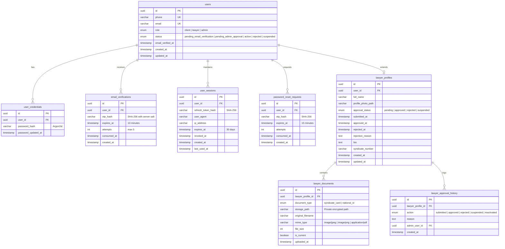

# خطة العمل الهندسية الشاملة: تنفيذ نظام الحسابات والمصادقة لتطبيق MyLawyer

**المشروع:** MyLawyer (ماي لوير) — `com.mylawyer.app`  
**المستودع الرسمي:** `https://github.com/samsamy67p/MyLawyer`  
**الخادم الفعلي:** `13.140.141.32` (Contabo VPS - Ubuntu 24.04 LTS)  
**المرحلة:** المرحلة 1 (Audit & Execution Architecture Plan)  

---

## 1. نتائج التدقيق الشامل (System & Infrastructure Audit)

### 1.1 حالة خادم VPS الفعلية (`13.140.141.32`)
- **المعالج والذاكرة:** 4 vCPUs AMD EPYC، الذاكرة المتاحة **7.1 GB** (المستخدم 667 MB فقط)، ومساحة القرص المتاحة **65 GB (11% مستخدم)**.
- **الشبكة والمنافذ المفتوحة الصادرة:**
  - تم اختبار الاتصال الصادر عبر المنفذ 25 (`smtp.gmail.com:25`) والمنفذ 587 (`smtp.gmail.com:587`) وكلاهما **مفتوح وناجح تماماً** (غير محجوب من مزود الخدمة).
- **خادم البريد Postfix & OpenDKIM:**
  - مثبت ويعمل بالفعل كخدمة نظام على المنفذ 25 محلياً (`127.0.0.1:25`) ومربوط بـ OpenDKIM على المنفذ `8891`.
- **قاعدة البيانات:**
  - محرك PostgreSQL غير مثبت حالياً على السيرفر (تم مسح MariaDB سابقاً لضمان بيئة نظيفة). سيتم تثبيت **PostgreSQL 16 LTS** مع إضافات `uuid-ossp` و `pgcrypto`.
- **بيئة التشغيل:** Node.js `v20.20.2` و npm `10.8.2` مثبتان وجاهزان، والـ Self-Hosted Runner `vps-mylawyer-node` يعمل بنجاح في الخلفية.

### 1.2 حالة الواجهة الأمامية الحالية (Frontend)
- **شاشة الدخول الحالية (`LoginScreen.jsx`):**
  - نموذج بسيط برقم هاتف وكلمة مرور يحفظ كائن زائف في `localStorage` بعد مؤقت 300ms.
- **النواقص المطلوبة في الواجهة:**
  1. شاشة تسجيل موحدة (`RegisterScreen`) تدعم اختيار نوع الحساب (موكل / محامٍ).
  2. حقول المحامي الإضافية: الاسم الكامل، رفع الصورة الشخصية، ورفع صورة كارنيه المحاماة مع المعاينة والتحقق.
  3. شاشة إدخال رمز التحقق OTP للبريد الإلكتروني مع عداد تنازلي وخيار إعادة الإرسال.
  4. شاشات الحالات الخاصة: شاشة «انتظار موافقة الإدارة»، شاشة «رفض الطلب مع ذكر السبب»، وشاشة «الحساب موقوف».
  5. دورة استعادة كلمة المرور المفقودة (`ForgotPasswordScreen` و `ResetPasswordScreen`).
  6. طبقة عميل API مركزية (`src/services/api/`) مع إدارة الـ Access/Refresh Tokens وتجديدها تلقائياً (Token Rotation).

---

## 2. مخطط قاعدة البيانات النهائي (Relational Database Schema)

سيتم إنشاء قاعدة بيانات باسم `mylawyer_prod` على PostgreSQL 16 بالهيكل التالي:

---

## 3. عقود الـ API المركزية (`/api/v1`)

| المسار (Endpoint) | الطريقة (Method) | الصلاحية (Auth) | الوصف |
| :--- | :--- | :--- | :--- |
| `/api/v1/auth/register` | `POST` | Public | تسجيل حساب موكل أو محامٍ وإرسال OTP البريد |
| `/api/v1/auth/verify-otp` | `POST` | Public | التحقق من OTP وتفعيل الموكل أو تحويل المحامي لانتظار الإدارة |
| `/api/v1/auth/resend-otp` | `POST` | Public | إعادة إرسال OTP مع حماية Rate Limiting (60 ثانية) |
| `/api/v1/auth/login` | `POST` | Public | تسجيل الدخول برقم الهاتف أو الإيميل والتحقق بـ Argon2id |
| `/api/v1/auth/refresh` | `POST` | Refresh Token | تدوير التوكن وإصدار Access Token جديد |
| `/api/v1/auth/logout` | `POST` | Bearer Token | إبطال الجلسة الحالية من قاعدة البيانات |
| `/api/v1/auth/forgot-password` | `POST` | Public | طلب كود استعادة كلمة المرور عبر البريد |
| `/api/v1/auth/reset-password` | `POST` | Public | تعيين كلمة المرور الجديدة بعد تأكيد OTP |
| `/api/v1/users/me` | `GET` | Bearer Token | جلب بيانات المستخدم الحالي وصلاحياته وحالته |
| `/api/v1/users/me` | `PATCH` | Bearer Token | تحديث البيانات الشخصية الأساسية |
| `/api/v1/lawyers/me` | `GET` | Bearer (Lawyer) | جلب تفاصيل ملف المحامي وحالة اعتماده |
| `/api/v1/lawyers/me/documents` | `POST` | Bearer (Lawyer) | رفع صورة كارنيه المحاماة وتخزينها في مسار محمي |
| `/api/v1/lawyers/me/profile-photo` | `POST` | Bearer (Lawyer) | رفع وتحديث الصورة الشخصية للمحامي |
| `/api/v1/documents/:id` | `GET` | Bearer (Admin/Owner)| تحميل المستند الخاص عبر تصريح مشفر ومؤقت |
| `/api/v1/admin/lawyers/pending` | `GET` | Bearer (Admin) | استعراض طلبات المحامين المعلقة للمراجعة |
| `/api/v1/admin/lawyers/:id/decision` | `POST` | Bearer (Admin) | اعتماد أو رفض المحامي مع حفظ السبب والسجل |

---

## 4. نظام رفع وحماية الملفات والمستندات (Upload Security Architecture)

1. **الصور الشخصية (Public Avatars):**
   - تُخزن في `/var/www/mylawyer/storage/public/avatars/`.
   - توليد اسم ملف عشوائي غير قابل للتخمين `UUIDv4 + extension`.
   - حد أقصى للحجم: 5 ميجابايت، ويُقبل فقط `image/jpeg`, `image/png`, `image/webp`.
   - فحص السحر الرقمي (Magic Bytes) للملف للتأكد من أنه صورة حقيقية وليس ملفاً تنفيذياً متنكراً.
2. **كارنيه المحاماة والمستندات القانونية (Private Documents):**
   - تُخزن في مجلد محمي معزول: `/var/www/mylawyer/storage/private_docs/`.
   - **يمنع Nginx منعاً باتاً من تقديم هذا المجلد مباشرة للويب** (`location /storage/private_docs { internal; return 403; }`).
   - لا يمكن قراءة الكارنيه إلا عبر استدعاء موثق `GET /api/v1/documents/:id` يتحقق من أن الطالب هو المحامي صاحب الشأن نفسه أو مسؤول يحمل صلاحية `admin`.

---

## 5. خدمة البريد الذاتية وإرسال OTP (Postfix SMTP Engine)

- سيتم الاعتماد كلياً على محرك **Postfix** المحلي العامل على السيرفر (`127.0.0.1:25`) عبر مكتبة `nodemailer`.
- **قالب البريد:** قالب HTML احترافي باللغة العربية متناسق مع هوية MyLawyer وألوانه الرسمية (`#1D4ED8`, `#0F172A`).
- **حماية رمز OTP:**
  - كود عشوائي مشفر ومكون من 6 أرقام.
  - مدة الصلاحية: 10 دقائق فقط.
  - حد أقصى للمحاولات الخاطئة: 5 محاولات قبل الإبطال التلقائي.
  - مهلة إعادة الإرسال (Cooldown): 60 ثانية لمنع الإغراق.
  - تخزين الرمز في قاعدة البيانات كـ `SHA-256 Hash` لحمايته حتى في حال تسريب قاعدة البيانات.

---

## 6. خطة التنفيذ الميدانية على مراحل متتابعة (Execution Phases)

- **المرحلة 2 (Database):** تثبيت حزم PostgreSQL 16 على الخادم، ضبط المستخدم والصلاحيات ومجمع الاتصالات `pg-pool`، وتنفيذ ملفات الـ Migrations.
- **المرحلة 3 (Backend):** بناء هيكل `backend/` بـ Fastify و TypeScript، مع وحدات `auth`, `users`, `lawyers`, `uploads`, `sessions` واستخدام تشفير Argon2id لكلمات المرور.
- **المرحلة 4 (Email):** ربط `nodemailer` بخادم Postfix المحلي، وتجهيز قالب البريد العربي وإجراء اختبار إرسال فعلي.
- **المرحلة 5 (Frontend):** تحديث `LoginScreen` وإضافة `RegisterScreen`، مكونات رفع ومعاينة الصور، شاشات OTP، وإدارة الجلسات وحفظ الـ Tokens بآلية آمنة.
- **المرحلة 6 (Testing & Integration):** تشغيل سيناريوهات الاختبار الـ 19 الواردة في معيار القبول.
- **المرحلة 7 (Deployment):** تشغيل الباك إند كخدمة Systemd دائمة، وتحديث إعدادات Nginx لربط `/api/` بالباك إند وخدمة الفرونت إند بسلاسة.

