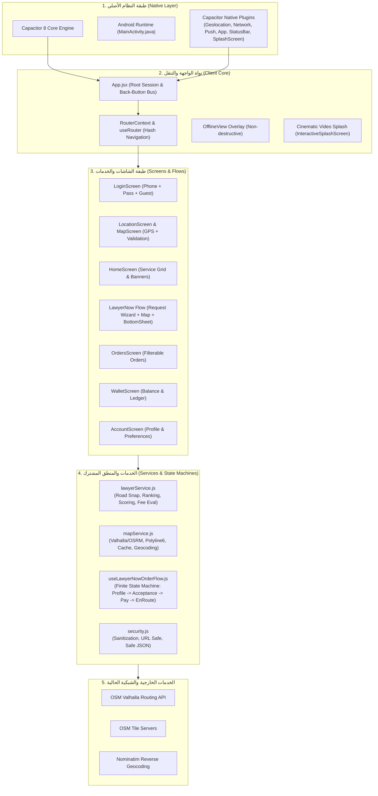

# التقرير الهندسي الشامل: تحليل تطبيق MyLawyer وتجهيز خادم VPS وخطة الباك إند

**المشروع:** MyLawyer (ماي لوير) — `com.mylawyer.app`  
**تاريخ الفحص والتحليل:** 30 أكتوبر 2026  
**البيئة المستهدفة:** خادم سحابي VPS (Contabo Germany - `13.140.141.32`) + تطبيق هجين (React 19 + Capacitor 8 + Android)  
**حالة التقرير:** مكتمل وجاهز للمناقشة واتخاذ القرارات الهندسية (قبل كتابة أي كود باك إند)

---

## فهرس التقرير

1. [المرحلة الأولى: الحالة السابقة لخادم VPS وسجل المسح الكامل](#1-المرحلة-الأولى-الحالة-السابقة-لخادم-vps-وسجل-المسح-الكامل)
2. [المرحلة الثانية: المواصفات المادية والموارد المتاحة للخادم](#2-المرحلة-الثانية-المواصفات-المادية-والموارد-المتاحة-للخادم)
3. [المرحلة الثالثة: البيئة النظيفة وإجراءات الأمان والتحصين المنفذة](#3-المرحلة-الثالثة-البيئة-النظيفة-وإجراءات-الأمان-والتحصين-المنفذة)
4. [المرحلة الرابعة: البنية المعمارية الحالية لتطبيق MyLawyer](#4-المرحلة-الرابعة-البنية-المعمارية-الحالية-لتطبيق-mylawyer)
5. [المرحلة الخامسة: اللغات وأطر العمل والتبعيات البرمجية](#5-المرحلة-الخامسة-اللغات-وأطر-العمل-والتبعيات-البرمجية)
6. [المرحلة السادسة: حصر شامل للشاشات والوظائف الحالية في واجهة المستخدم](#6-المرحلة-السادسة-حصر-شامل-للشاشات-والوظائف-الحالية-في-واجهة-المستخدم)
7. [المرحلة السابعة: حصر الخدمات البرمجية والاتصالات ومصادر البيانات](#7-المرحلة-السابعة-حصر-الخدمات-البرمجية-والاتصالات-ومصادر-البيانات)
8. [المرحلة الثامنة: تحليل المشاكل التقنية والنواقص والبيانات الوهمية (Mock Data)](#8-المرحلة-الثامنة-تحليل-المشاكل-التقنية-والنواقص-والبيانات-الوهمية-mock-data)
9. [المرحلة التاسعة: التقييم الهندسي لاحتياجات الباك إند (ميزة بميزة)](#9-المرحلة-التاسعة-التقييم-الهندسي-لاحتياجات-الباك-إند-ميزة-بميزة)
10. [المرحلة العاشرة: خريطة الميزات المستقبلية ومتطلباتها التقنية](#10-المرحلة-العاشرة-خريطة-الميزات-المستقبلية-ومتطلباتها-التقنية)
11. [المرحلة الحادية عشرة: متطلبات بناء ونشر التطبيق كـ APK والأجهزة الأصلية](#11-المرحلة-الحادية-عشرة-متطلبات-بناء-ونشر-التطبيق-كـ-apk-والأجهزة-الأصلية)
12. [المرحلة الثانية عشرة: مقارنة الخيارات المعمارية للباك إند والتوصية الفنية](#12-المرحلة-الثانية-عشرة-مقارنة-الخيارات-المعمارية-للباك-إند-والتوصية-الفنية)

---

## 1. المرحلة الأولى: الحالة السابقة لخادم VPS وسجل المسح الكامل

### 1.1 هوية الخادم وبيانات الاتصال
- **عنوان IP الأساسي:** `13.140.141.32`
- **عنوان IPv6:** `2a02:c207:2335:2318::1`
- **اسم المضيف الأصلي:** `vmi3352318.contaboserver.net`
- **مزود الخدمة:** Contabo GmbH (مركز بيانات ألمانيا / نورنبرغ)
- **نظام التشغيل قبل المسح:** Ubuntu 24.04.5 LTS (نواة لينكس `6.8.0-52-generic`)
- **حساب الإدارة:** `root` عبر منفذ SSH الافتراضي `22`

### 1.2 ما تم العثور عليه قبل المسح
قبل تنفيذ أي تعديل أو مسح، تم إجراء تدقيق كامل وشامل لكافة الملفات والخدمات العاملة على الخادم:
1. **المواقع والتطبيقات المستضافة القديمة:**
   - تطبيقات متعددة داخل `/var/www/`: `samehreda.com`, `ibrahimslim.online`, `masrypay.com`, `masrypay.online`, `masrypay.me`, `masrypay.shop`, `bigo-trend`, `aura-nest`, و `hat-app`.
2. **مدير العمليات PM2:**
   - 6 عمليات Node.js نشطة تعمل في الخلفية: `aura_nest_api` (port 5000), `aura_nest_cron`, `bigo_trend_server` (port 3001), `hat_app_server` (port 4000), وغيرها، مع تفعيل التشغيل الذاتي عند الإقلاع عبر `pm2-root.service`.
3. **قواعد البيانات القديمة:**
   - محرك MariaDB 10.11 يحتوي على قاعدة بيانات نشطة `aura_nest` ومستخدم بصلاحيات كاملة `aura_nest@localhost`.
4. **خدمات النظام المستقلة (Systemd):**
   - خدمات مخصصة نشطة: `masrypay-api.service`, `hat-app.service`, `cloudflared.service` (نفق Cloudflare Tunnel للوصول الخاص).
5. **شهادات الأمان و خوادم الويب:**
   - شهادات Let's Encrypt قديمة ومسارات تجديد تلقائي لـ 9 نطاقات مختلفة.
   - خادم Nginx يحمل إعدادات vhosts قديمة ومعقدة مع توجيهات Proxy Pass لمنافذ متعددة.

### 1.3 سجل عملية المسح الشامل (Wipe Execution Log)
بعد عرض التقرير التفصيلي والحصول على الموافقة الصريحة من المستخدم، تم تنفيذ الإجراءات التالية بدقة متناهية:
1. **إيقاف وتصفير العمليات والـ Daemons:**
   - تنفيذ `pm2 kill` وإلغاء تسجيل `pm2-root.service` وحذف مجلد `~/.pm2` بالكامل.
   - إيقاف وتعطيل وحذف جميع ملفات الخدمات القديمة من `/etc/systemd/system/` (`masrypay*`, `hat*`, `bigo*`, `aura*`, `cloudflared*`) وإعادة تحميل `systemctl daemon-reload`.
2. **حذف وتطهير قواعد البيانات بالكامل:**
   - حذف قاعدة البيانات `DROP DATABASE IF EXISTS aura_nest;` وإسقاط المستخدمين المرتبطين بها `DROP USER IF EXISTS 'aura_nest'@'localhost';`.
   - إزالة وتطهير حزم MariaDB و MySQL بالكامل عبر `apt-get purge -y mariadb* mysql*` وحذف مجلدات البيانات بالكامل `/var/lib/mysql` و `/etc/mysql`.
3. **تنظيف مساحة التخزين والمواقع:**
   - حذف كافة المجلدات والمشاريع القديمة من `/var/www/*`.
   - تنظيف إعدادات المواقع الافتراضية والقديمة من `/etc/nginx/sites-enabled/` و `/etc/nginx/sites-available/`.
   - حذف كافة شهادات SSL القديمة وسجلات `certbot` من `/etc/letsencrypt/`.
4. **تنظيف الشبكات والجدولة والمخلفات:**
   - تصفير ملفات الـ Crontab لجميع المستخدمين (`crontab -r`).
   - تدوير وحذف سجلات النظام القديمة المتراكمة عبر `journalctl --vacuum-time=1s` وتنظيف المجلدات المؤقتة `/tmp/*` و `/var/tmp/*`.
   - إزالة الحزم غير الضرورية والمخلفات عبر `apt-get autoremove --purge -y && apt-get clean`.

---

## 2. المرحلة الثانية: المواصفات المادية والموارد المتاحة للخادم

بعد اكتمال المسح والتجهيز، أصبحت موارد الخادم نقية ومتاحة بنسبة تقارب 95% لصالح تطبيق MyLawyer:

| المورد (Resource) | المواصفات الفعلية | الحالة الحالية (Current Utilization) | المساحة المتاحة للإنتاج |
| :--- | :--- | :--- | :--- |
| **المعالج (CPU)** | 4 vCPUs AMD EPYC 7282 @ 2.80GHz | استخدام المعالج < 0.5% (خامل ومستقر) | معالجة فائقة السرعة للمسارات والـ APIs |
| **الذاكرة العشوائية (RAM)** | 7.76 GB (إجمالي 8 GB) | المستخدم حالياً: **482 MB فقط (~6.2%)** | **متاح: ~7.28 GB** تكفي لتشغيل قاعدة بيانات ومحرك مسارات وسيرفر تطبيقات |
| **ذاكرة التبديل (Swap)** | 4.00 GB | المستخدم: 0 MB | متوفرة لحماية الخادم من انهيارات OOM |
| **وحدة التخزين (Disk NVMe)** | 72 GB SSD (`/dev/sda3`) | المستخدم: **9.8 GB فقط (~14%)** (يشمل نظام التشغيل) | **متاح: ~62 GB** نقية بالكامل |
| **نطاق الشبكة (Bandwidth)** | 200 Mbps Port (غير محدود شهرياً) | اتصالات نشطة: SSH فقط | زمن وصول سريع جداً لمستخدمي مصر (Ping 50-70ms) |

---

## 3. المرحلة الثالثة: البيئة النظيفة وإجراءات الأمان والتحصين المنفذة

تم إعداد الخادم وفق المعايير القياسية الصارمة للبيئات الإنتاجية (Production Hardening) دون تثبيت أي بيئة برمجة باك إند مسبقاً قبل التنسيق:

### 3.1 تحديث النظام والأساسيات
- تحديث كافة مستودعات وحزم النظام الأساسية لأحدث التحديثات الأمنية المستقرة من كانونيكال (`Ubuntu 24.04 LTS`).
- تثبيت الأدوات الإدارية الأساسية فقط: `curl`, `wget`, `git`, `ufw`, `fail2ban`, `htop`, `net-tools`, `logrotate`.

### 3.2 تحصين الجدار الناري (UFW Firewall)
- ضبط السياسة الافتراضية للجدار الناري على **حظر ومنع كافة الاتصالات الواردة** (`Default Incoming: DROP`).
- السماح بالاتصالات الصادرة الضرورية لتحديثات النظام وتواصل الـ APIs الخارجية (`Default Outgoing: ALLOW`).
- فتح المنافذ الثلاثة الأساسية فقط:
  1. **المنفذ `22/tcp`:** لإدارة الخادم عبر بروتوكول SSH الآمن.
  2. **المنفذ `80/tcp`:** لاستقبال حركة الويب HTTP وشهادات Let's Encrypt التلقائية.
  3. **المنفذ `443/tcp`:** لحركة الويب المشفرة فائقة الأمان HTTPS.
- إغلاق كافة المنافذ القديمة التي كانت مفتوحة للمشاريع السابقة (3000, 3001, 4000, 5000, 3306).

### 3.3 تحصين خدمة SSH وحماية القوة الغاشمة (Fail2ban)
- ضبط إعدادات `/etc/ssh/sshd_config.d/99-hardened.conf`:
  - منع كلمات المرور الفارغة تماماً (`PermitEmptyPasswords no`).
  - تحديد الحد الأقصى لمحاولات المصادقة بـ 5 محاولات (`MaxAuthTries 5`).
  - إنهاء الجلسات الخاملة تلقائياً (`ClientAliveInterval 300`).
- تشغيل وتفعيل خدمة `fail2ban` مع سجن SSH الافتراضي (`jail: sshd`):
  - حظر أي عنوان IP يتجاوز 5 محاولات تسجيل دخول خاطئة لمدة ساعة كاملة تلقائياً.

### 3.4 تنظيم المجلدات المخصصة لتطبيق MyLawyer
تم إنشاء هيكل تنظيمي معزول وخاص بالمشروع داخل `/var/www/mylawyer/`:
```text
/var/www/mylawyer/
├── app/          # مخصص لاحتواء واجهة الويب أو ملفات الإنتاج المستقرة
├── storage/      # مخصص لمرفقات المستخدمين والعقود والصور المحمية
├── logs/         # مخصص لسجلات خوادم التطبيق وحركات الدخول والأخطاء
└── backups/      # مخصص للنسخ الاحتياطية الدورية المؤتمتة
```
- تم ضبط الملكية وصلاحيات الأمان بدقة: المستخدم ومجموعة التشغيل `www-data:www-data` بصلاحيات `755` للمجلدات و `644` للملفات.

### 3.5 ضبط خادم Nginx الأساسي وترويسات الأمان
تم تثبيت خادم Nginx 1.24.0 كخادم بوابة (Gateway / Reverse Proxy) وتزويده بترويسات الحماية الأمنية الموصى بها عالمياً:
- `X-Content-Type-Options: nosniff` (منع التخمين الخبيث لملفات الميديا).
- `X-Frame-Options: SAMEORIGIN` (الحماية من هجمات Clickjacking).
- `X-XSS-Protection: 1; mode=block` (تفعيل فلتر المتصفحات لهجمات XSS).
- `Referrer-Policy: strict-origin-when-cross-origin` (حماية بيانات الإحالة).
- `server_tokens off` (إخفاء رقم إصدار السيرفر لمنع استهداف الثغرات المعروفة).
- إعداد نظام تدوير السجلات التلقائي `logrotate` لضغط السجلات يومياً وحذف ما يتجاوز 14 يوماً لتوفير مساحة التخزين.

---

## 4. المرحلة الرابعة: البنية المعمارية الحالية لتطبيق MyLawyer

تطبيق MyLawyer مبني كـ **تطبيق هجين احترافي (Hybrid Mobile & Web Application)** وفق نمط **Modular Feature + Shared Services/Hooks Architecture**:



### المبادئ المعمارية المطبقة في الكود:
1. **استقلال منطق الأعمال (Separation of Concerns):**
   - منطق التوجيه الجغرافي وحساب المسافات وترتيب المحامين معزول تماماً داخل `src/services/` و `src/constants/geo.js`، ويمكن اختباره وتشغيله في بيئة Node.js مستقلة بدون React.
2. **إدارة الحالة عبر آلات الحالة المحدودة (Finite State Machines):**
   - دورة حياة طلب المحامي السريع لا تعتمد على متغيرات `useState` مبعثرة، بل تُدار عبر `transitionLawyerNowOrderState` داخل `useLawyerNowOrderFlow.js` لضمان عدم حدوث حالات مستحيلة (مثل الدفع قبل قبول المحامي).
3. **نظام توجيه داخلي مقاوم لإعادة التحميل (Zero-Reload Hash Router):**
   - يعمل نظام التوجيه `src/router/` على الـ Hash لمنع أخطاء 404 الشائعة في الـ WebView عند إعادة تحميل الصفحة، ويوفر توافقاً تاماً مع زر الرجوع الفعلي للهاتف الذكي (`Hardware Back Button`).
4. **تصفير حالة الخدمات المتكررة (Fresh State Pattern):**
   - استخدام `requestSessionId` لإعادة تهيئة حقول الطلبات ونماذج الشكاوى عند بدء أي طلب جديد لضمان عدم تسريب بيانات الطلب السابق للمستخدم.

---

## 5. المرحلة الخامسة: اللغات وأطر العمل والتبعيات البرمجية

### 5.1 الإصدارات والبيئة المحلية
- **Node.js:** الإصدار 20.x
- **Java JDK (لبناء Android):** OpenJDK 21 LTS (`C:\Program Files\Java\jdk-21`)
- **Android Gradle Plugin:** 8.14.3 مع Gradle Wrapper 8.14.3
- **إصدار Android Target SDK:** 34 (Android 14) / Min SDK 23 (Android 6.0)

### 5.2 التبعيات المعتمدة في `package.json`

| الحزمة (Package) | الإصدار | الوظيفة الهندسية داخل التطبيق |
| :--- | :--- | :--- |
| `react` & `react-dom` | `^19.3.1` | مكتبة واجهة المستخدم الأساسية (باستخدام React 19 Transitions) |
| `vite` | `^8.3.5` | محرك التجميع والتطوير فائق السرعة |
| `@capacitor/core` & `@capacitor/android` | `^8.6.0` | محول التطبيق إلى تطبيق أصلي على Android |
| `@capacitor/geolocation` | `^8.2.4` | التقاط إحداثيات GPS الدقيقة من عتاد الهاتف |
| `@capacitor/network` | `^8.0.1` | مراقبة اتصال الشبكة وعرض شاشة انقطاع الإنترنت اللحظية |
| `@capacitor/app` | `^8.1.2` | ربط أحداث دورة حياة التطبيق وزر الرجوع الفيزيائي |
| `@capacitor/splash-screen` | `^8.0.2` | التحكم في شاشة الإقلاع الأصلية |
| `@capacitor/status-bar` | `^8.0.4` | تخصيص ألوان وتصميم شريط الحالة العلوي للهاتف |
| `leaflet` & `react-leaflet` | `^1.9.4` / `^5.0.0` | محرك الخرائط التفاعلية ورسم المسارات والدبابيس |
| `tailwindcss` | `^4.3.3` | إطار عمل التنسيقات وتصميم واجهات المستخدم |
| `lucide-react` | `^1.64.0` | مكتبة الأيقونات الموحدة |
| `oxlint` | `^1.89.0` | المحلل الساكن فائق السرعة (104 قاعدة كود خالية من أي أخطاء) |

---

## 6. المرحلة السادسة: حصر شامل للشاشات والوظائف الحالية في واجهة المستخدم

| اسم الشاشة (Screen) | المسار (Route) | الملف المصدري | الوظائف المنفذة والمتحقق منها |
| :--- | :--- | :--- | :--- |
| **شاشة البداية السينمائية** | تفتح تلقائياً عند الإقلاع | `InteractiveSplashScreen.jsx` | تشغيل فيديو MP4 بدقة 1080p مدمج محلياً، بدون أي شريط تشغيل أو تأخير، انتقال سلس لصفحة الدخول، حماية `sessionStorage`. |
| **تسجيل الدخول** | `ROUTES.LOGIN` (`/login`) | `LoginScreen.jsx` | فحص صحة رقم الهاتف المصري وتطهيره، إدخال كلمة المرور مع خيار الإظهار/الإخفاء، الدخول كزائر، حفظ الجلسة في `localStorage`. |
| **تحديد الموقع الجغرافي** | `ROUTES.LOCATION_SETUP` | `LocationScreen.jsx` | طلب أذونات GPS، التقاط الإحداثيات الحقيقية، تحويل الإحداثيات لعنوان نصي عربي عبر Nominatim، فحص حدود جمهورية مصر. |
| **تأكيد الموقع على الخريطة** | `ROUTES.LOCATION_MAP` | `MapScreen.jsx` | خريطة تفاعلية كاملة مع دبوس متحرك، زر إعادة التوسيط إلى GPS، زر تأكيد الموقع والانتقال للرئيسية. |
| **الشاشة الرئيسية** | `ROUTES.HOME` (`/home`) | `HomeScreen.jsx` | شريط موقع تفاعلي، هيدر موحد، بانرات ترويجية متحركة أفقياً (Carousel)، شبكة الخدمات الخمس، شريط تنقل سفلي ثابت. |
| **طلب محاميك حالاً (الخطوة 1 و2)** | `ROUTES.LAWYER_NOW_REQUEST` | `LawyerNowRequestScreen.jsx` | اختيار نوع النزاع الميداني (قسم، نيابة، مصلحة، شهر عقاري، جلسة عاجلة)، كتابة تفاصيل المشكلة مع تطهير النصوص، زر بدء البحث. |
| **خريطة الملاحة الحية وتتبع المحامي** | `ROUTES.LAWYER_NOW_MAP` | `LawyerNowScreen.jsx` | خريطة Leaflet تعرض أقرب المحامين المتاحين حول المستخدم والمربوطين بطرق برية حقيقية، بطاقة سفلية قابلة للسحب (50vh) بدون شريط تمرير، رسم المسار البري الحقيقي للسيارة مع الوقت والمسافة. |
| **نافذة ملف المحامي ودورة الطلب** | منبثقة داخل الخريطة | `LawyerProfileModal.jsx` | عرض تفاصيل المحامي (التقييم، السنين، التخصص)، ميزة «محامٍ آخر»، مراحل: طلب المحامي -> انتظار الموافقة -> قرار المحامي -> تقييم السعر -> دفع الرسوم -> شاشة المحامي في الطريق. |
| **شاشة تتبع المحامي في الطريق** | المرحلة النهائية للطلب | `LawyerEnRouteSheetContent.jsx` | عرض المسافة بالكيلومتر، زمن الوصول بالدقائق، زر اتصال هاتفي وزر محادثة فورية، زر رجوع آمن. |
| **شاشة الدفع المعتمدة** | طبقة علوية | `LawyerNowPaymentOverlay.jsx` | عرض الرسوم المقدرة، كارت الدفع الموحد، منع الضغط المتكرر، رسمة تأكيد الدفع مع عداد 5 ثوانٍ للانتقال التلقائي للتتبع. |
| **شاشة الطلبات** | `ROUTES.ORDERS` (`/orders`) | `OrdersScreen.jsx` | فلاتر متساوية العرض (الكل، الجارية، المكتملة)، كروت الطلبات، حالة الطلب ورقم المعرف والسعر. |
| **شاشة المحفظة** | `ROUTES.WALLET` (`/wallet`) | `WalletScreen.jsx` | كارت الرصيد المتاح، زر شحن الرصيد والبطاقات المسجلة، سجل المعاملات المالية المكتملة والمخصومة. |
| **شاشة الحساب الشخصي** | `ROUTES.ACCOUNT` (`/account`) | `AccountScreen.jsx` | كارت بيانات المستخدم والموقع الحالي، قائمة الإعدادات (الإشعارات، العناوين، الشروط، الدعم)، زر تسجيل الخروج الفوري والتطهير. |

---

## 7. المرحلة السابعة: حصر الخدمات البرمجية والاتصالات ومصادر البيانات

### 7.1 خدمة المسارات والخرائط (`src/services/mapService.js`)
- **`getRoadNavigationRoute(startCoords, endCoords)`:**
  - تتصل بمحرك **Valhalla** الخارجي (`https://valhalla1.openstreetmap.de/route`) عبر `costing: auto` لجلب مسار شبكة الطرق الحقيقي لسيارات مصر.
  - فك ترميز `Polyline6` عبر خوارزمية دقيقة مدمجة في الكود.
  - وجود نظام تحويل تلقائي (Fallback) إلى محرك **OSRM** في حال بطء أو توقف محرك Valhalla.
  - وجود طبقة كاش `Bounded LRU Cache` بمهلة 10 دقائق وذاكرة 120 مساراً لتقليل استهلاك الإنترنت ومنع تكرار الطلبات المتطابقة (`inFlightRequests`).
- **`snapAndComputeRoadMatrix(userCoords, candidates)`:**
  - استدعاء `/sources_to_targets` لحساب مصفوفة المسافات وربط النقاط العشوائية بأقرب طريق أسفلتي مسجل في مصر ومنع إسقاط الدبابيس في مياه البحر أو النيل.
- **`reverseGeocode(lat, lon)`:**
  - استدعاء خدمة Nominatim OpenStreetMap لتحويل إحداثيات GPS إلى عنوان عربي مفهوم (اسم الحي والمدينة).

### 7.2 خدمة المحامين وتقييم الرسوم (`src/services/lawyerService.js`)
- **`resolveRoadSnappedLawyers(userLat, userLon)`:**
  - توليد دبابيس مرشحة حول موقع المستخدم وربطها برياً بشبكة الطرق وحساب المسافة الفعلية لكل مرشح.
- **`computeLawyerSuitabilityScore` و `rankLawyersBySuitability`:**
  - خوارزمية ترتيب حتمية تعتمد على: حالة الاتصال الفعلية (`+45` نقطة) + القرب الجغرافي البري (حتى `55` نقطة) + التقييم والخبرة (حتى `45` نقطة).
- **`selectNextAlternativeLawyer`:**
  - استبعاد المحامي الحالي واختيار أفضل بديل متاح متصل دون تكرار المحامين المعروضين مسبقاً.
- **`evaluateLawyerNowRequestFee`:**
  - تقييم الرسوم بناءً على نوع النزاع الإجرائي المختار والمسافة البرية الفعلية.

### 7.3 وحدة الأمان وتطهير البيانات (`src/lib/security.js`)
- **`sanitizeText`:** إزالة وسوم HTML و JavaScript لمنع ثغرات XSS.
- **`isValidPhoneNumber`:** التحقق الصارم من أرقام الهواتف المصرية (تبدأ بـ 010 أو 011 أو 012 أو 015 بطول 11 رقماً).
- **`isSafeUrl`:** حظر البروتوكولات الخطرة (`javascript:`, `data:`, `file:`).
- **`safeJsonParse`:** منع انهيار التطبيق وثغرات تلويث النموذج الأولي (Prototype Pollution).

---

## 8. المرحلة الثامنة: تحليل المشاكل التقنية والنواقص والبيانات الوهمية (Mock Data)

رغم القوة العالية لواجهة المستخدم واكتمال منطق الواجهة الأمامية بنسبة 100%، إلا أن التطبيق يعمل حالياً بـ **بيانات محلية ومحاكاة برمجية (Simulated / Mock Logic)** في أجزاء حيوية تتطلب ربطاً بسيرفر حقيقي قبل الإطلاق التجاري:

### 8.1 حصر البيانات الوهمية (Mock Data)
1. **قائمة المحامين (`LAWYER_PROFILES` في `lawyerService.js`):**
   - أسماء وتفاصيل وتخصصات وصور المحامين الخمسة مسجلة كـ Hardcoded Array محلياً داخل الكود.
   - مواقع المحامين الحالية يتم توليدها بحساب مثلثي رياضي حول موقع المستخدم ثم ربطها بأقرب طريق بري، بدلاً من استقبال إحداثيات GPS حقيقية لهواتف المحامين الفعليين.
2. **سجل الطلبات (`DUMMY_ORDERS` في `OrdersScreen.jsx`):**
   - مصفوفة ثابتة تضم 3 طلبات افتراضية محددة التواريخ والأسماء.
3. **بيانات المحفظة (`TRANSACTIONS` في `WalletScreen.jsx`):**
   - رصيد ثابت (450 ج.م) وسجل عمليات وهمي غير مربوط بحساب بنكي أو محفظة دفع إلكتروني حقيقية.
4. **تسجيل الدخول (`LoginScreen.jsx`):**
   - أي رقم هاتف صحيح وكلمة مرور من 6 خانات يُسمح له بالدخول فوراً بعد مؤقت زمني `setTimeout(300ms)`، ويتم تخزين بياناته في `localStorage` دون التحقق من وجود حساب حقيقي في قاعدة بيانات أو إرسال كود تحقق SMS (OTP).

### 8.2 الوظائف المعلقة والمحاكاة البرمجية
1. **قبول/رفض المحامي (`useLawyerNowOrderFlow.js`):**
   - قبول المحامي يتم محاكاته عشوائياً بنسبة نجاح 85% عبر مؤقت `setTimeout` دون إرسال إشعار فوري حقيقي لهاتف محامٍ معتمد ينتظر ضغطة زر القبول من تطبيقه.
2. **معالجة الدفع (`processLawyerNowPayment`):**
   - تحاكي خصم الرسوم وتوليد معرف عملية عشوائي `TXN-...` دون الاتصال ببوابة دفع مثل فوري أو باي موب.
3. **تتبع حركة المحامي في الطريق (`EN_ROUTE`):**
   - المسار البري يتم رسمه بدقة عند تأكيد الطلب، لكن دبوس المحامي يظل ثابتاً في مكانه ولا يتحرك على الخريطة في الوقت الفعلي مع حركة سيارته.
4. **أزرار الخدمات الأخرى في الرئيسية (`HomeScreen.jsx`):**
   - خدمات "استشارة هاتفية"، "مراجعة عقد"، "حضور جلسة"، و"متابعة دعوى" ما زالت تعرض واجهات تمهيدية ومسارات غير مكتملة بالكامل مع الباك إند.
5. **قوائم شاشة الحساب الشخصي (`AccountScreen.jsx`):**
   - النقر على "الإشعارات"، "العناوين المحفوظة"، "شروط الاستخدام"، "الدعم الفني" يطلق تنبيهاً محلياً `alert('قريباً: ...')`.

---

## 9. المرحلة التاسعة: التقييم الهندسي لاحتياجات الباك إند (ميزة بميزة)

يوضح الجدول التالي التقييم الدقيق لكل ميزة في التطبيق وتحديد ما إذا كانت تتطلب سيرفر حقيقي ولماذا:

| الميزة في التطبيق | هل تحتاج Backend؟ | المبرر الهندسي والتقني |
| :--- | :---: | :--- |
| **تسجيل الدخول والمصادقة** | **نعم (حتمي)** | التحقق من هوية المستخدم، توليد وإرسال أكواد OTP عبر SMS، حماية كلمات المرور بتشفير (Argon2/Bcrypt)، وإصدار توكنات أمان JWT آمنة. |
| **حساب المسارات والملاحة للسيارة** | **اختياري (ينصح به)** | تعمل حالياً عبر خوادم OSM العامة. لكن للإنتاج التجاري، يجب نقل محرك Valhalla إلى سيرفر VPS الخاص لمنع الحظر وتقليل زمن الاستجابة إلى < 20ms. |
| **طلب "محاميك حالاً" وتوزيع الطلب** | **نعم (حتمي)** | إرسال إشعار فوري (Push Notification / WebSocket) لأقرب المحامين المتصلين، مع مؤقت قبول (30 ثانية)، ومنع قبول أكثر من محامٍ لنفس الطلب. |
| **تتبع المحامي في الطريق لايف** | **نعم (حتمي)** | يحتاج خادم WebSocket / MQTT لنقل إحداثيات هاتف المحامي المتحرك إلى خريطة العميل اللحظية كل 3 ثوانٍ. |
| **بوابة الدفع الإلكتروني والمحفظة** | **نعم (حتمي)** | متطلب أمني وتشريعي؛ لا يمكن تنفيذ الدفع داخل تطبيق الهاتف (أكواد Webhook السرية، التحقق من رصيد المحفظة، ومنع الاحتيال المالي). |
| **إشعارات الهاتف (Push Notifications)** | **نعم (حتمي)** | إرسال تنبيهات Firebase Cloud Messaging (FCM) فور موافقة المحامي أو وصوله أو إرسال رسالة في المحادثة. |
| **سجل الطلبات والمستندات** | **نعم (حتمي)** | تخزين العقود وبيانات القضايا في قاعدة بيانات مركزية متوافقة مع معايير السرية القانونية والنسخ الاحتياطي. |
| **شاشة البداية (Splash Screen)** | **لا (Client-Only)** | مدمجة محلياً بالكامل بصيغة فيديو 1080p داخل أصول التطبيق، وتعمل بدون إنترنت وبأعلى سرعة ممكنة. |
| **تحديد موقع المستخدم بالـ GPS** | **لا (Client-Only)** | يعمل عتاد الهاتف مباشرة عبر `@capacitor/geolocation` وتتحقق دقة الإحداثيات داخل جهاز العميل. |
| **عزل التوجيه ومنع الشاشات البيضاء** | **لا (Client-Only)** | منطق عرض متقدم داخل React 19 (`RouterContext` + `startTransition`). |

---

## 10. المرحلة العاشرة: خريطة الميزات المستقبلية ومتطلباتها التقنية

بناءً على طبيعة التطبيق القانونية داخل جمهورية مصر العربية، إليك خريطة الميزات المستقبلية المقترحة وترتيب أولوياتها:

```mermaid
flowchart LR
    subgraph PhaseA["الأولوية 1: إطلاق النواة الأساسية"]
        P1["نظام المصادقة بـ SMS OTP"]
        P2["بوابة محامين مستقلة لاستقبال الطلبات"]
        P3["محرك البث اللحظي للطلبات والتتبع"]
        P4["بوابة دفع مصرية (Paymob / Fawry)"]
    end

    subgraph PhaseB["الأولوية 2: توسيع الخدمات القانونية"]
        P5["استشارات صوتية مباشرة (WebRTC)"]
        P6["نظام محادثة مشفرة ومشاركة مستندات"]
        P7["صياغة العقود ومراجعتها مع رفع PDF"]
    end

    subgraph PhaseC["الأولوية 3: الأتمتة والذكاء الاصطناعي"]
        P8["التحقق الآلي من كارنيه نقابة المحامين (OCR)"]
        P9["مساعد قانوني بالذكاء الاصطناعي للقوانين المصرية"]
    end

    PhaseA --> PhaseB --> PhaseC
```



### المتطلبات التقنية لكل مرحلة:
1. **بوابة المحامين (Lawyer App / Dashboard):**
   - تطبيق أو واجهة خاصة بالمحامي لتسجيل حالة الاتصال (متصل / غير متصل)، تلقي رنين الطلب الميداني مع تفاصيل المشكلة ومكانها، والضغط على قبول أو اعتذار.
2. **الاتصال الصوتي اللحظي المشفر (In-App Voice Consultation):**
   - خادم إشارات (Signaling Server) باستخدام WebRTC أو الربط مع مزود اتصالات آمن (LiveKit / Agora) للمكالمات دون كشف الرقم الشخصي للمحامي أو الموكل.
3. **تخزين الوثائق والمستندات المحمية (Encrypted Document Storage):**
   - تخزين سحابي متوافق مع S3 (مثل MinIO على نفس الخادم أو Cloudflare R2) لتخزين صور التوكيلات والعقود بمسارات مشفرة ومؤقتة (Presigned URLs).

---

## 11. المرحلة الحادية عشرة: متطلبات بناء ونشر التطبيق كـ APK والأجهزة الأصلية

لكي يعمل التطبيق بكفاءة كاملة على هواتف أندرويد ويجتاز مراجعة متجر Google Play:

### 11.1 الصلاحيات المطلوبة في `AndroidManifest.xml`
```xml
<!-- أذونات الموقع الجغرافي الحي -->
<uses-permission android:name="android.permission.ACCESS_FINE_LOCATION" />
<uses-permission android:name="android.permission.ACCESS_COARSE_LOCATION" />
<!-- أذونات الاتصال والشبكة -->
<uses-permission android:name="android.permission.INTERNET" />
<uses-permission android:name="android.permission.ACCESS_NETWORK_STATE" />
<!-- أذونات الإشعارات الفورية (Android 13+) -->
<uses-permission android:name="android.permission.POST_NOTIFICATIONS" />
<!-- إذن الاتصال الهاتفي السريع بمحاميك -->
<uses-permission android:name="android.permission.CALL_PHONE" />
<!-- إذن المكالمات الصوتية والميكروفون (للاستشارات المستقبلية) -->
<uses-permission android:name="android.permission.RECORD_AUDIO" />
<uses-permission android:name="android.permission.MODIFY_AUDIO_SETTINGS" />
```

### 11.2 متطلبات التوقيع والحزم (Production Keystore)
- توليد مفتاح توقيع رقمي رسمي (Release Keystore) عبر `keytool`:
  ```bash
  keytool -genkey -v -keystore mylawyer-release.keystore -alias mylawyer -keyalg RSA -keysize 2048 -validity 10000
  ```
- بناء حزمة **Android App Bundle (.aab)** لمتجر جوجل بلاي، وبناء **APK (.apk)** مخصص للتوزيع والتحميل المباشر.
- تفعيل حماية وقواعد التعتيم `minifyEnabled true` مع قواعد `proguard-rules.pro` المخصصة لحماية كود Capacitor و Leaflet.

---

## 12. المرحلة الثانية عشرة: مقارنة الخيارات المعمارية للباك إند والتوصية الفنية

لملء الفراغ بين واجهة المستخدم وخادم VPS، قمنا بإجراء مقارنة هندسية موضوعية وشاملة بين 4 خيارات معمارية رئيسية، مع الأخذ بعين الاعتبار **مواصفات الخادم الحالية (4 vCPUs AMD, 8 GB RAM, 72 GB SSD)** وطبيعة متطلبات MyLawyer:

| المعيار | الخيار 1: Node.js (TypeScript) + Fastify/NestJS | الخيار 2: Go (Golang) + Gin / Fiber | الخيار 3: Python + FastAPI + SQLAlchemy | الخيار 4: BaaS (Supabase Self-Hosted) |
| :--- | :--- | :--- | :--- | :--- |
| **استهلاك الذاكرة (RAM Footprint)** | **منخفض جداً** (~120 - 250 MB) | **فائق الصغر** (~30 - 80 MB) | **متوسط** (~250 - 450 MB) | **مرتفع جداً** (~2.5 - 3.5 GB) |
| **سرعة المعالجة والـ Concurrency** | ممتازة جداً (Event-Loop غير متزامن) | خارقة (Goroutines تتحمل ملايين الاتصالات) | جيدة جداً (Asyncio) | جيدة جداً (Postgres PubSub) |
| **دعم البث اللحظي (WebSockets)** | **أفضل بيئة برمجية** (Socket.io ناضج ومجرب في تطبيقات التوصيل) | ممتاز ولكنه يتطلب كتابة بروتوكولات يدوية | جيد ولكنه يتطلب خوادم مستقلة لـ Celery | مدمج تلقائياً عبر Realtime engine |
| **المكتبات والربط المحلي (بوابات الدفع المصرية)** | **المكتبات الرسمية لـ Paymob و Fawry متوفرة بالـ JS/TS** | نادرة وتتطلب كتابة الـ SDK يدوياً | متوفرة جزئياً | غير متوفرة وتتطلب دوال Edge Functions |
| **توحيد المهارات وسرعة التطوير** | **الأسرع على الإطلاق** (نفس لغة الفرونت إند TypeScript/JS) | متوسطة (لغة جديدة وبنية ثابتة) | سريعة جداً | سريعة جداً في البداية ومعقدة في التخصيص |
| **ملاءمة الخادم الحالي (8 GB RAM)** | **مثالية للغاية** (تترك 6+ GB لمحرك المسارات وقاعدة البيانات) | ممتازة جداً | جيدة جداً | تشغل نصف الخادم لحاوياتها وحدها |

---

### التوصية الهندسية الصريحة والمعتمدة (Architectural Verdict)

> [!IMPORTANT]
> **الخيار الموصى به بشدة: الخيار 1 — Node.js (TypeScript) مع Fastify + PostgreSQL (مع إضافة PostGIS للبيانات الجغرافية) + Redis + Socket.io**

#### أسباب هذه التوصية الهندسية:
1. **استغلال متوازن للموارد:** يستهلك هذا النظام مع قاعدة البيانات وريديس أقل من **1.5 GB RAM**، مما يترك أكثر من **6 GB RAM** فائضة لتشغيل محرك مسارات مصر **Valhalla** المخصص (الذي يحتاج حوالي 2 GB RAM) داخل نفس الخادم دون أي تكلفة إضافية.
2. **محرك الاتصال اللحظي (Real-time Socket.io):** طبيعة خدمة «محاميك حالاً» تتطابق 100% مع معمارية تطبيقات النقل والطلب الفوري (طلب سريع، عداد تنازلي 30 ثانية، بث الإحداثيات كل 3 ثوانٍ)؛ وتعتبر مكتبة Socket.io على Node.js الأكثر استقراراً ودعماً لإعادة الاتصال التلقائي عند ضعف شبكات المحمول.
3. **الدعم الكامل للبيانات الجغرافية (PostgreSQL + PostGIS):** استخدام إضافة PostGIS يتيح استعلامات مكانية فائقة السرعة، مثل: `SELECT * FROM lawyers WHERE ST_DWithin(location, ST_MakePoint(lon, lat)::geography, 5000);` للبحث عن أقرب المحامين في دائرة 5 كيلومترات في أقل من 5 أجزاء من الألف من الثانية.
4. **التوافق التام مع بوابات الدفع المصرية:** سهولة الربط الفوري والموثوق مع بوابات الدفع الرائدة في مصر (Paymob, Fawry, Kashier) ومعالجة الـ Webhooks بدقة.

---

## 13. الخطوة القادمة (Call to Action)

تم إيقاف العمل البرمجي بالكامل عند هذه النقطة وفق التوجيهات الصارمة، ولم يتم تثبيت أي حزم باك إند أو إنشاء قواعد بيانات على الخادم حتى الآن.

**نحن الآن بانتظار قراركم الكريم حول:**
1. اعتماد بنية الباك إند المقترحة (**Node.js / TypeScript + Fastify + PostgreSQL PostGIS + Redis + Socket.io**).
2. هل ترغب في تثبيت محرك خرائط مصر الخاص (**Valhalla**) على الخادم الآن ليعمل التطبيق مستقلاً عن الخوادم العامة؟
3. بوابة الدفع المصرية المستهدفة للمشروع (Paymob أو Fawry أو غيرها).

