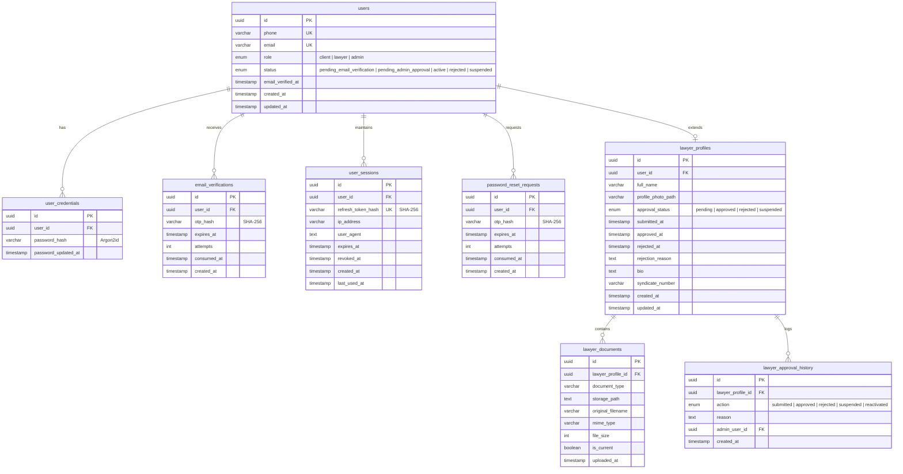

# مخطط قاعدة البيانات وإدارة الترحيلات (Database Schema & Migrations)

**محرك قاعدة البيانات:** PostgreSQL 16 LTS  
**اسم قاعدة البيانات الإنتاجية:** `mylawyer_prod`  
**دليل الترحيلات:** `backend/migrations/`  
**مشغل الترحيل:** `npm run migrate` (داخل مجلد `backend`)  

---

## 1. مخطط الكيانات والعلاقات (Entity-Relationship Diagram)



---

## 2. تفاصيل الجداول والحقول والفهارس (Tables & Indexes Catalog)

### 2.1 جدول المستخدمين الأساسي (`users`)
- `id` (UUID): المفتاح الرئيسي الفريد، مولد تلقائياً عبر `gen_random_uuid()`.
- `phone` (VARCHAR 30): رقم الهاتف مع قيد التفرد `UNIQUE`.
- `email` (VARCHAR 255): البريد الإلكتروني مع قيد التفرد `UNIQUE`.
- `role` (ENUM: `client`, `lawyer`, `admin`): دور المستخدم وصلاحياته.
- `status` (ENUM: `pending_email_verification`, `pending_admin_approval`, `active`, `rejected`, `suspended`): حالة تفعيل الحساب الحالية.
- `email_verified_at` (TIMESTAMPTZ): توقيت اكتمال تأكيد البريد الإلكتروني بنجاح.
- **الفهارس:**
  - `idx_users_email`: فهرس B-Tree للبحث السريع بالبريد الإلكتروني.
  - `idx_users_phone`: فهرس B-Tree لتسجيل الدخول الفوري برقم الهاتف.
  - `idx_users_role_status`: فهرس مركب لاستعلام المستخدمين حسب الدور والحالة.

### 2.2 جدول بيانات الاعتماد السرية (`user_credentials`)
- `id` (UUID): المفتاح الرئيسي.
- `user_id` (UUID): معرف المستخدم `REFERENCES users(id) ON DELETE CASCADE`.
- `password_hash` (VARCHAR 255): تجزئة كلمة المرور باستخدام خوارزمية **Argon2id**.
- `password_updated_at` (TIMESTAMPTZ): توقيت آخر تحديث لكلمة المرور.

### 2.3 جدول رموز التحقق من البريد (`email_verifications`)
- `id` (UUID): المفتاح الرئيسي.
- `user_id` (UUID): معرف المستخدم.
- `otp_hash` (VARCHAR 64): تجزئة رمز التحقق SHA-256 مع ملح السيرفر.
- `expires_at` (TIMESTAMPTZ): صلاحية الرمز (10 دقائق افتراضياً).
- `attempts` (INT): عدد محاولات الإدخال الخاطئة (بحد أقصى 5 محاولات قبل الإبطال).
- `consumed_at` (TIMESTAMPTZ): وقت استهلاك الرمز بنجاح.

### 2.4 جدول جلسات المستخدم والتوكن (`user_sessions`)
- `id` (UUID): المفتاح الرئيسي.
- `user_id` (UUID): معرف المستخدم المرتبط بالجلسة.
- `refresh_token_hash` (VARCHAR 64): تجزئة توكن التجديد مع قيد التفرد `UNIQUE`.
- `user_agent` (TEXT): هوية المتصفح ونظام التشغيل.
- `ip_address` (VARCHAR 45): عنوان IP للاتصال.
- `expires_at` (TIMESTAMPTZ): تاريخ انتهاء صلاحية الجلسة (30 يوماً).
- `revoked_at` (TIMESTAMPTZ): تاريخ إلغاء وتجميد الجلسة عند تسجيل الخروج.

### 2.5 جدول ملفات المحامين المهنية (`lawyer_profiles`)
- `id` (UUID): المفتاح الرئيسي.
- `user_id` (UUID): معرف حساب المحامي في جدول المستخدمين.
- `full_name` (VARCHAR 255): الاسم الكامل الصريح للمحامي.
- `syndicate_number` (VARCHAR 100): رقم القيد بنقابة المحامين.
- `approval_status` (ENUM): حالة اعتماد الحساب (`pending`, `approved`, `rejected`, `suspended`).
- `bio` (TEXT): نبذة تعريفية وخبرات المحامي وتخصصاته.
- `profile_photo_path` (TEXT): مسار الصورة الشخصية المعتمدة.

### 2.6 جدول مستندات وكارنيهات المحامين (`lawyer_documents`)
- `id` (UUID): المفتاح الرئيسي.
- `lawyer_profile_id` (UUID): معرف ملف المحامي.
- `document_type` (VARCHAR 50): نوع الوثيقة (`syndicate_card`, `national_id`).
- `storage_path` (TEXT): المسار الآمن والمعزول للملف على السيرفر.
- `original_filename` (VARCHAR 255): اسم الملف الأصلي عند الرفع.
- `mime_type` (VARCHAR 100): نوع الملف المفحوص (`image/jpeg`, `image/png`, `application/pdf`).
- `file_size` (INT): حجم الملف بالبايت.
- `is_current` (BOOLEAN): تحديد ما إذا كانت هذه الوثيقة هي النسخة السارية حالياً.

### 2.7 جدول سجل القرارات الإدارية للمحامين (`lawyer_approval_history`)
- `id` (UUID): المفتاح الرئيسي.
- `lawyer_profile_id` (UUID): معرف ملف المحامي.
- `action` (ENUM): نوع الإجراء المتخذ (`submitted`, `approved`, `rejected`, `suspended`, `reactivated`).
- `reason` (TEXT): سبب القرار الإداري المسجل من قبل الإدارة.
- `admin_user_id` (UUID): معرف المشرف الذي اتخذ القرار.
- `created_at` (TIMESTAMPTZ): التوقيت الزمني الدقيق للقرار.

### 2.8 جدول طلبات الخدمات الميدانية الفورية (`service_orders`) — ترحيل 002
- `id` (UUID): المفتاح الرئيسي المولد تلقائياً.
- `order_number` (VARCHAR 32): رقم الطلب الفريد الموجه للمستخدمين (مثال: `ORD-202610-8921`).
- `client_id` (UUID FK -> users.id): معرف حساب الموكل طالب الخدمة.
- `lawyer_id` (UUID FK -> users.id): معرف حساب المحامي المكلف بالمهمة.
- `service_type` (VARCHAR 50): نوع الخدمة (`lawyer_now`, `consultation`, `contract`).
- `service_title` (VARCHAR 255): عنوان ومسمى الخدمة الميدانية.
- `problem_type` (VARCHAR 100): التصنيف الفرعي المختار في الخطوة الأولى.
- `problem_description` (TEXT): الشرح التفصيلي للمشكلة المدخل من الموكل.
- `client_latitude` / `client_longitude` (NUMERIC 10,7): الإحداثيات الجغرافية لموقع الموكل.
- `client_address` (TEXT): العنوان النصي المعرب لموقع الموكل.
- `lawyer_latitude` / `lawyer_longitude` (NUMERIC 10,7): إحداثيات موقع المحامي عند استقبال الطلب.
- `price` (NUMERIC 10,2): الرسوم المقدرة والمسددة للطلب بالجنيه المصري.
- `status` (VARCHAR 30): حالة دورة حياة الطلب (`PENDING`, `ACCEPTED`, `REJECTED`, `ACTIVE`, `COMPLETED`, `CANCELLED`).
- `cancellation_reason` / `rejection_reason` (TEXT): أسباب الإلغاء أو الاعتذار المسجلة.
- `accepted_at` / `completed_at` / `cancelled_at` (TIMESTAMPTZ): التوقيتات الدقيقة للانتقالات.
- `created_at` / `updated_at` (TIMESTAMPTZ): توقيت الإنشاء والتحديث التلقائي عبر Trigger.

### 2.9 جدول سجل العمليات والتدقيق للطلبات (`order_status_logs`) — ترحيل 002
- `id` (UUID): المفتاح الرئيسي.
- `order_id` (UUID FK -> service_orders.id): معرف الطلب المرتبط.
- `changed_by_user_id` (UUID FK -> users.id): معرف المستخدم الذي أجرى التغيير (موكل، محامٍ، أو مدير).
- `old_status` (VARCHAR 30): الحالة السابقة للطلب.
- `new_status` (VARCHAR 30): الحالة الجديدة بعد الانتقال.
- `note` (TEXT): ملاحظات توضيحية لسبب الانتقال أو الإجراء المتخذ.
- `created_at` (TIMESTAMPTZ): التوقيت الزمني الدقيق للعملية.

---

## 3. كيفية تشغيل الترحيلات وإضافة تعديلات مستقبلية

1. **تشغيل الترحيلات القائمة:**
```bash
cd my_lawyer/backend
npm run migrate
```
2. **إضافة ترحيل جديد:**
   - أنشئ ملفاً جديداً في `backend/migrations/` بالترقيم المتسلسل (مثال: `002_add_orders_table.sql`).
   - اكتب أوامر SQL باستخدام صيغ متسامحة مع التكرار (`CREATE TABLE IF NOT EXISTS`, `ADD COLUMN IF NOT EXISTS`).
   - شغّل أمر `npm run migrate`؛ سيقوم السكربت بفحص جدول `schema_migrations` وتطبيق الملف الجديد تلقائياً داخل Transaction موثوقة.

