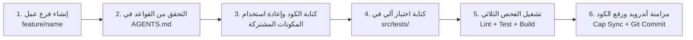

# دليل المطور وإرشادات المساهمة (Developer & Contribution Guide)

مرحباً بك في فريق تطوير **MyLawyer (`com.mylawyer.app`)**. يهدف هذا الدليل إلى توفير إرشادات هندسية واضحة لأي مطور ينضم إلى المشروع لضمان جودة الكود، وسلاسة العمل، ومنع أي كسر للميزات القائمة.

---

## 1. الإعداد الأولي لبيئة التطوير المحلية (Local Development Setup)

### 1.1 المتطلبات الأساسية:
- **Node.js:** الإصدار `v20.x` LTS (أو أحدث).
- **npm:** الإصدار `10.x` (أو أحدث).
- **PostgreSQL:** الإصدار 16 (اختياري محلياً، ويمكن الربط بسيرفر التطوير).
- **نظام التشغيل:** Windows 10/11، macOS، أو Linux Ubuntu.

### 1.2 خطوات التشغيل السريع:
```bash
# 1. استنساخ المستودع
git clone https://github.com/samsamy67p/MyLawyer.git
cd MyLawyer/my_lawyer

# 2. تثبيت اعتماديات الواجهة الأمامية
npm install

# 3. تثبيت اعتماديات الباك إند
cd backend
npm install
cd ..

# 4. نسخ ملف متغيرات البيئة وتعبئة البيانات
cp .env.example .env
cp backend/.env.example backend/.env

# 5. تشغيل سيرفر الواجهة الأمامية المحلي
npm run dev

# 6. تشغيل سيرفر الباك إند المحلي (في نافذة طرفية منفصلة)
cd backend
npm run dev
```

---

## 2. خريطة الملفات وتوزيع الأدوار (Project Directory Structure)

```
my_lawyer/
├── src/
│   ├── assets/              # الرسوم والشعارات (SVG, Icons, Illustrations)
│   ├── components/          # المكونات المشتركة
│   │   ├── auth/            # مكونات المصادقة (ProtectedRoute, StatusScreens)
│   │   ├── feedback/        # رسائل الخطأ، التنبيهات، وشاشات التحميل (Toast, Boundary)
│   │   ├── layout/          # الهيكل العام (Header, BottomNav, NavigationBar)
│   │   ├── map/             # مكونات الخريطة التفاعلية والمسارات (LeafletMap)
│   │   └── ui/              # عناصر الواجهة القياسية (Button, Input, Card, Modal)
│   ├── constants/           # الثوابت الرقمية والجغرافية (geo.js, colors.js)
│   ├── context/             # سياقات الحالة العامة (AuthContext.jsx)
│   ├── hooks/               # خطافات React المخصصة (useLawyerNowOrderFlow, useNearbyLawyersRoute)
│   ├── lib/                 # المكتبات المساعدة وتطهير المدخلات (security.js)
│   ├── router/              # نظام التوجيه الداخلي لـ WebView (RouterContext.jsx, routes.js)
│   ├── screens/             # الشاشات الرئيسية للتطبيق (Client, Lawyer, Auth, Orders)
│   ├── services/            # عملاء الـ API والخدمات الجغرافية (apiClient.js, lawyerService.js)
│   ├── tests/               # الاختبارات الآلية الشاملة (35 اختباراً ناجحاً)
│   ├── App.jsx              # نقطة الدخول وإدارة الرجوع الفعلي والطبقات
│   └── main.jsx             # تركيب شجرة React
├── backend/
│   ├── src/
│   │   ├── config/          # إعدادات البيئة والمفاتيح
│   │   ├── database/        # مجمع اتصال PostgreSQL ومشغل الترحيلات
│   │   ├── modules/         # وحدات الـ API (auth, users, lawyers, admin)
│   │   ├── services/        # خدمات البريد والتشفير (emailService.ts)
│   │   ├── utils/           # دوال الأمان والتحقق من المدخلات (security.ts)
│   │   ├── app.ts           # تهيئة Fastify وإعداد الحماية
│   │   └── server.ts        # تشغيل الخادم
│   └── migrations/          # ملفات ترحيل SQL المرقمة
├── android/                 # مشروع تطبيق أندرويد الأصلي (Capacitor)
├── docs/                    # التوثيق الهندسي الشامل المعتمد
├── AGENTS.md                # القواعد السبعة عشر الإلزامية للمطورين والنماذج
└── PROJECT_GUIDE.md         # الدليل الهندسي الشامل للتطبيق
```

---

## 3. دورة حياة إضافة ميزة برمجية جديدة (Feature Workflow)

إذا طُلب منك إضافة ميزة جديدة أو شاشة جديدة، اتبع الخطوات الست التالية بالترتيب:



### 3.1 أوامر الفحص الآلي الإلزامية قبل أي Commit:
```bash
# 1. فحص الكود الساكن (يجب أن ينتج 0 أخطاء و 0 تحذيرات)
npm.cmd run lint

# 2. تشغيل جناح الاختبارات الآلية (يجب أن تجتاز بنسبة 100%)
npm.cmd test

# 3. بناء الحزمة الإنتاجية لـ Vite
npm.cmd run build

# 4. إذا عُدلت ملفات في الباك إند:
cd backend
npm.cmd run build
npx.cmd oxlint src
cd ..

# 5. مزامنة تطبيق أندرويد
npx.cmd cap sync android
```

---

## 4. قائمة التحقق قبل اعتماد أي طلب دمج (PR Checklist)

- [ ] تم قراءة والالتزام الصارم بالقواعد الإلزامية في `AGENTS.md`.
- [ ] لم يتم تعديل أو تشويه الهوية البصرية (الألوان `#1D4ED8`, `#0F172A`, `#F8FAFC` والخط `ThmanyahSans` ونصف القطر `7px`).
- [ ] تم استخدام الهيدر الموحد `Header.jsx` مع العنوان المناسب وزر الرجوع عند الحاجة.
- [ ] تم استخدام مكون الزر الموحد `Button.jsx` لجميع الإجراءات مع معالجة التحميل `isLoading`.
- [ ] تم تطهير جميع مدخلات المستخدم بدالة `sanitizeText`.
- [ ] لا توجد أي أسرار أو كلمات مرور مسجلة في الكود أو السجلات.
- [ ] جميع الاختبارات في `src/tests/` تمر بنجاح تام (35 اختباراً).
- [ ] الفحص الساكن بـ `oxlint` نظيف 100% بدون أي أخطاء أو تحذيرات.
- [ ] تم توثيق أي مسارات أو متغيرات جديدة في هذا الدليل.
