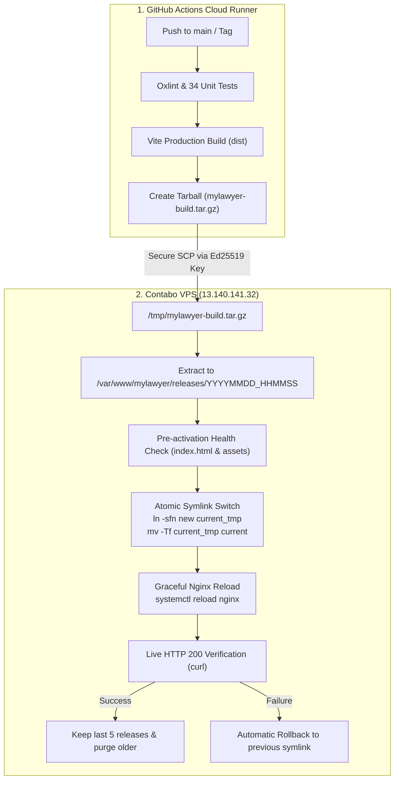

# دليل دورة التطوير والنشر التلقائي وإدارة الإصدارات (CI/CD & Release Guide)

**المستودع الرسمي المعتمد:** [`https://github.com/samsamy67p/MyLawyer`](https://github.com/samsamy67p/MyLawyer)  
**خادم الإنتاج:** `13.140.141.32` (Contabo Germany)  
**نظام النشر المعتمد:** Zero-Downtime Atomic Symlink Deployment  

---

## 1. بنية Git وإدارة الفروع والإصدارات (Git Strategy)

### 1.1 الفروع المعتمدة (Branching Model)
- **`main` (فرع الإنتاج المستقر):**
  - الفرع الأساسي المحمي؛ أي `push` أو دمج (Merge) إليه يؤدي تلقائياً إلى تشغيل الاختبارات ثم النشر المباشر على سيرفر الإنتاج بدون أي توقف للخدمة.
- **`develop` (فرع التطوير والتكامل):**
  - الفرع المخصص لجمع الميزات الجديدة واختبارها محلياً قبل دمجها في `main`.
- **فروع الميزات (`feature/*`) والإصلاحات (`fix/*`):**
  - تنشأ من `develop` ويتم اختبارها وتدقيقها ثم دمجها عبر Pull Request.

### 1.2 التسميات والوسوم (Semantic Versioning & Release Tags)
يتبع المشروع معيار `vMAJOR.MINOR.PATCH`:
- `v1.0.0`: الإصدار الإنتاجي الأولي المعتمد.
- `v1.0.1`: إصلاحات برمجية سريعة (Patches/Hotfixes).
- `v1.1.0`: إضافة ميزة جديدة متوافقة مع الإصدارات السابقة (Minor features).
- `v2.0.0`: تعديلات جذرية أو معمارية رئيسية (Breaking changes).

#### أوامر إنشاء الوسوم ورفعها:
```bash
# إنشاء Tag لإصدار جديد مع رسالة وصفية
git tag -a v1.0.0 -m "Release v1.0.0: Initial production release with cinematic splash and live routing"

# رفع الـ Tag إلى GitHub لتسجيل Release رسمي
git push origin v1.0.0
```

---

## 2. آلية النشر الذري دون انقطاع الخدمة (Zero-Downtime Deployment Architecture)

تعتمد البنية المنفذة على تقنية **الروابط الرمزية الذرية (Atomic Symlinks)** المتبعة في كبرى المنصات العالمية لضمان عدم توقف الخدمة ولو لجزء من الثانية (0ms Downtime):



### كيف يضمن هذا النظام عدم انقطاع الخدمة أثناء التحديث؟
1. الإصدار الجديد يُفك ضغطه ويُجهّز بالكامل داخل مجلد مستقل معزول `releases/20261030_XXXXXX`.
2. يتم فحص سلامة الملفات واكتمال `index.html` قبل تحويل أي مستخدم إليها.
3. التبديل يتم عبر أمر لينكس الذري `mv -Tf` الذي يستبدل الرابط الرمزي `current` في جزء من الألف من الثانية على مستوى نظام الملفات (Inode Level).
4. خادم Nginx يقرأ المسار الجديد فوراً دون الحاجة لإعادة تشغيل السيرفر (`systemctl reload nginx` يُكمل الطلبات النشطة للعملاء الحاليين ويوجه الطلبات الجديدة للإصدار الأحدث بسلاسة تامة).
5. في حال حدوث أي خطأ غير متوقع، يتراجع السكربت فوراً إلى الرابط الرمزي السابق `previous` ويعيد تحميل Nginx تلقائياً.

---

## 3. إدارة التراجع السريع واستعادة الإصدارات (Rollback Procedures)

### 3.1 التراجع التلقائي (Automated Rollback):
- مدمج داخل سكربت النشر `/var/www/mylawyer/deploy.sh`؛ إذا أرجع فحص الصحة المباشر أي كود غير `200 OK`، يتم التراجع فوراً خلال ثانية واحدة واستعادة الإصدار السابق.

### 3.2 التراجع اليدوي بضغطة زر من GitHub Actions (1-Click UI Rollback):
1. افتح صفحة المستودع على GitHub واذهب إلى تبويب **Actions**.
2. اختر مسار العمل **MyLawyer CI/CD Pipeline**.
3. اضغط على زر **Run workflow**.
4. في خانة **Action to perform**، اختر `rollback` واضغط **Run workflow**.
5. سيتصل الـ Pipeline بالسيرفر ويفعل الإصدار السابق فوراً مع التحقق من نجاح العملية.

### 3.3 التراجع اليدوي المباشر من سيرفر VPS:
في حالات الطوارئ القصوى أو انقطاع الاتصال بـ GitHub، يمكنك الدخول للسيرفر وتنفيذ أمر التراجع في سطر واحد:
```bash
ssh root@13.140.141.32
/var/www/mylawyer/rollback.sh
```

---

## 4. الفرق بين تحديثات الويب وتحديثات التطبيق الأصلي (Web vs Native Updates)

| نوع التغيير | هل يتطلب بناء APK جديد ورفعه للمتجر؟ | كيف يصل للمستخدمين؟ |
| :--- | :---: | :--- |
| **تعديل نصوص، ألوان، تصميم واجهات، ميزات UI** | **لا** | بمجرد الـ `git push` على `main`، يُحدث السيرفر فوراً ويراه مستخدمو الويب والنسخ المتصلة. |
| **تعديل منطق التوجيه أو خوارزميات ترتيب المحامين** | **لا** | يتم تحديث الكود على السيرفر مباشرة. |
| **إضافة إضافة Capacitor جديدة (مثل بصمة الإصبع أو كاميرا)** | **نعم (حتمي)** | يتطلب تحديث `MainActivity` و `AndroidManifest` وبناء APK جديد عبر `gradlew assembleRelease`. |
| **تغيير أذونات أندرويد (Permissions)** | **نعم (حتمي)** | إضافة صلاحيات جديدة يتطلب موافقة نظام أندرويد وتحديث ملف APK. |
| **تغيير أيقونة التطبيق الأصلية أو شاشة الإقلاع الأصلية في أندرويد** | **نعم (حتمي)** | ملفات `res/drawable` مدمجة داخل حزمة الـ APK ولا يمكن تحديثها عبر السيرفر. |

---

## 5. إدارة الأسرار والمفاتيح (Secrets Management)

تم تشفير وتخزين جميع بيانات الاتصال الحساسة داخل **GitHub Repository Secrets**، ولا يُسمح بحفظها داخل الكود المصدري نهائياً:

- `VPS_HOST`: عنوان السيرفر (`13.140.141.32`).
- `VPS_PORT`: منفذ SSH الآمن (`22`).
- `VPS_USER`: اسم مستخدم السيرفر (`root`).
- `VPS_SSH_KEY`: مفتاح Ed25519 المشفر والمولد خصيصاً لـ GitHub Actions.

---

## 6. خطوات التحضير لاستيعاب مليون مستخدم مستقبلاً (Roadmap to 1 Million Users)

لضمان عمل النظام بكفاءة عندما يتضاعف عدد المستخدمين إلى مليون مستخدم نشط:
1. **تفعيل شبكة توصيل المحتوى (Cloudflare CDN):** وضع Cloudflare أمام خادم VPS لخدمة كافة ملفات الواجهة والخطوط والصور وبلاطات الخرائط من حواف سيرفرات مصرية وعالمية مع حماية DDoS مجانية.
2. **عزل قاعدة البيانات ومحرك المسارات:** نقل قاعدة بيانات PostgreSQL ومحرك مسارات Valhalla إلى خوادم داخلية مخصصة مرتبطة بشبكة سحابية خاصة (Private VPC).
3. **التوسع الأفقي (Horizontal Scaling):** تشغيل عدة خوادم تطبيقات (Node.js App Nodes) خلف Load Balancer موحد (مثل HAProxy أو AWS ALB / Hetzner Load Balancer).
4. **تخزين الجلسات والبث اللحظي في Redis Cluster:** ضمان مزامنة إشعارات ومواقع المحامين لحظياً بين كافة السيرفرات دون فقدان أي اتصال.

